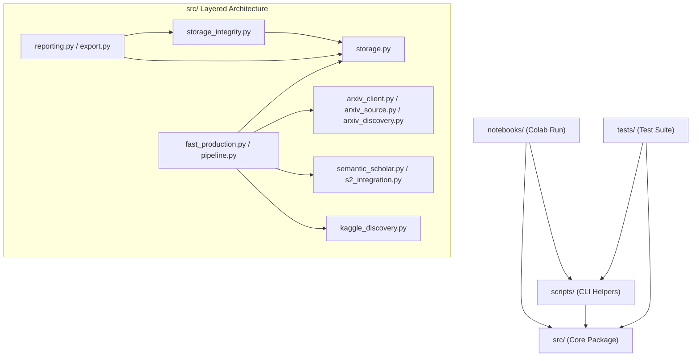

# Kiến Trúc Kho Lưu Trữ & Quy Tắc Tổ Chức Mã Nguồn (Repository Architecture & Structure)

**Dự án:** arXiv Data Crawler & Production Corpus Pipeline — Group 10  
**Tài liệu tham chiếu:** [`docs/architecture/repository-inventory.md`](repository-inventory.md)  
**Ngày cập nhật:** 2026-11-09  

---

## 1. Mục Tiêu Thiết Kế Kiến Trúc (Architecture Goals)

Kiến trúc kho lưu trữ được thiết kế nhằm đạt được các mục tiêu sau:
1. **Phân định trách nhiệm rõ ràng (Separation of Concerns):** Phân chia minh bạch giữa tầng lõi xử lý nghiệp vụ (`src/`), tầng giao diện vận hành kịch bản (`scripts/`), tầng sổ tay tương tác trên đám mây (`notebooks/`), tầng quy chuẩn kỹ thuật (`docs/`) và tầng kiểm thử bảo đảm chất lượng (`tests/`).
2. **Tính độc lập & Fail-Closed (Independent Verification):** Các tầng kiểm toán dữ liệu và đối soát chỉ số (`src/storage_integrity.py`, `src/reporting.py`) hoạt động độc lập với tầng ghi dữ liệu (`src/storage.py`), bảo đảm mọi lỗi kiểm tra đều fail-closed.
3. **Tính tái lập & Tự chứa (Reproducibility & Self-Containment):** Mọi tài liệu đặc tả môn học gốc (`request/`), cấu hình phân bổ ID (`config/`), và mã nguồn đều nằm trực tiếp trong repository, bảo đảm khả năng tái lập môi trường và kết quả 100% ngoại tuyến.

---

## 2. Sơ Đồ Cấu Trúc Thư Mục (Directory Tree)

```text
Arxiv-Project-Group10/
├── .github/
│   └── workflows/
│       └── tests.yml                 # CI tự động chạy toàn bộ test suite trên Python 3.11 & 3.12
├── config/                           # Cấu hình phân bổ định danh và tập mẫu
│   ├── group10_id_ranges.json        # Nguồn chân lý: 4 dải ID / 20.000 bài báo cho 4 MSSV
│   └── pilots/                       # Tập con định danh mẫu phục vụ thử nghiệm
│       ├── pilot_10.json             # 10 ID mẫu (smoke test)
│       └── pilot_500.json            # 500 ID mẫu (benchmark tải vừa)
├── docs/                             # Tài liệu kỹ thuật phân tầng
│   ├── acceptance/                   # Nghiệm thu và bàn giao
│   │   ├── M1_FINAL_ACCEPTANCE.md    # Báo cáo nghiệm thu toàn diện Milestone 1
│   │   └── M1_HANDOFF.md             # Sổ tay bàn giao và hướng dẫn vận hành Colab
│   ├── architecture/                 # Kiến trúc hệ thống và kiểm kê
│   │   ├── repository-inventory.md   # Kiểm kê chi tiết 98 tệp và ma trận trách nhiệm
│   │   └── repository-structure.md   # Tài liệu kiến trúc cấu trúc hiện tại
│   ├── audits/                       # Báo cáo kiểm toán kỹ thuật
│   │   ├── fast_production_audit.md  # Báo cáo kiểm toán fast production runner
│   │   └── m1_finalization.md        # Tiêu chí chốt kỹ thuật M1
│   ├── contracts/                    # Quy chuẩn lưu trữ và chỉ số báo cáo
│   │   ├── m1_contract.md            # Storage Contract v2 cho cấu trúc bài báo
│   │   ├── reporting_metrics.md      # Đặc tả chỉ số báo cáo và invariants
│   │   └── storage.md                # Quy chuẩn ghi đĩa, atomic commit và manifest
│   ├── guides/                       # Hướng dẫn chi tiết từng module
│   │   ├── arxiv_client.md           # HTTP client arXiv kèm rate limit & backoff
│   │   ├── arxiv_discovery.md        # Phân tích cú pháp Atom XML, xác định phiên bản
│   │   ├── arxiv_source.md           # Tải source tarball, lọc và giải nén TeX/Bib
│   │   ├── batch.md                  # Điều phối batch, logs và checkpoint
│   │   ├── colab.md                  # Hướng dẫn vận hành Google Colab cơ bản
│   │   ├── fast_crawling_guide.md    # Hướng dẫn runner sản xuất tốc độ cao trên SSD
│   │   ├── id_ranges.md              # Quản lý dải định danh và MSSV
│   │   ├── pipeline.md               # Quy trình pipeline tuần tự tích hợp
│   │   ├── s2_integration.md         # Bật/tắt và chuẩn hóa dữ liệu Semantic Scholar
│   │   └── semantic_scholar.md       # Client Semantic Scholar Graph API
│   └── operations/                   # Hướng dẫn vận hành và đo lường
│       ├── benchmark_runner.md       # Runner đo lường hiệu năng và tài nguyên
│       ├── colab_comparison.md       # Hướng dẫn thực nghiệm đối chứng A/B
│       ├── live_smoke.md             # Hướng dẫn kiểm thử smoke có kiểm soát
│       └── m1_production.md          # Hướng dẫn runner sản xuất tuần tự
├── notebooks/                        # Sổ tay Google Colab CPU-only
│   ├── m1_colab_fast_production.ipynb     # Sổ tay sản xuất chính thức của nhóm (200 cohorts)
│   ├── m1_colab_arxiv_production.ipynb    # Sổ tay sản xuất baseline tuần tự (tham chiếu)
│   ├── m1_colab_cpu_pilot.ipynb           # Sổ tay pilot đo đạc I/O Google Drive
│   └── m1_colab_strategy_comparison.ipynb # Sổ tay so sánh đối chứng A/B chiến lược
├── reports/                          # Báo cáo kiểm toán độc lập bảo lưu lịch sử
│   └── remediation/                  # Báo cáo remediation các giai đoạn trước
├── request/                          # Đề bài và quy định gốc của giảng viên
│   ├── crawling.md                   # Đặc tả Milestone 1 (Crawling)
│   ├── index.md                      # Tổng quan đồ án thực hành
│   ├── link.md                       # Liên kết phân bổ đề tài
│   ├── matching.md                   # Đặc tả Milestone 3
│   ├── paper.md                      # Đề bài gốc
│   └── parsing.md                    # Đặc tả Milestone 2
├── scripts/                          # Kịch bản dòng lệnh hỗ trợ
│   ├── colab_comparison.py           # Tiện ích phục vụ notebook so sánh chiến lược
│   ├── generate_m1_report.py         # Kịch bản CLI xuất báo cáo kiểm toán M1
│   ├── live_smoke.py                 # Kịch bản live smoke test cục bộ
│   ├── m1_production.py              # Runner sản xuất dòng lệnh tuần tự
│   └── make_pilots.py                # Kịch bản sinh lại các tập pilot
├── src/                              # Mã nguồn Python lõi
│   ├── __init__.py                   # Package marker
│   ├── arxiv_client.py               # HTTP client arXiv
│   ├── arxiv_discovery.py            # Atom XML parser
│   ├── arxiv_source.py               # Source tarball extractor
│   ├── batch.py                      # Batch orchestration & attempt logs
│   ├── benchmark.py                  # Core benchmark measurement foundation
│   ├── benchmark_runner.py           # Benchmark adapter & reporting
│   ├── export.py                     # Data export engine (Parquet / CSV)
│   ├── fast_production.py            # High-performance crawler engine
│   ├── id_ranges.py                  # ID ranges config loader & validator
│   ├── kaggle_discovery.py           # Offline metadata preload from Kaggle
│   ├── local_config.py               # Environment variable loader (.env)
│   ├── pilots.py                     # Deterministic pilot generator
│   ├── pipeline.py                   # Sequential end-to-end pipeline
│   ├── reporting.py                  # Independent reconciliation & audit metrics
│   ├── s2_integration.py             # Semantic Scholar integration layer
│   ├── semantic_scholar.py           # Semantic Scholar API client
│   ├── storage.py                    # Storage engine (atomic write, manifest, checksum)
│   └── storage_integrity.py          # Structured fail-closed integrity auditor
├── tests/                            # 1.030 unit tests ngoại tuyến
│   ├── test_*.py                     # 29 tệp test bao phủ toàn bộ module trong src/
├── CONTRIBUTING.md                   # Quy chuẩn đóng góp mã nguồn và quy trình kiểm thử
├── LICENSE                           # Giấy phép mã nguồn mở MIT
├── pytest.ini                        # Cấu hình test runner pytest (pythonpath = .)
├── README.md                         # Tài liệu giới thiệu tổng quan dự án
├── requirements.txt                  # Phụ thuộc môi trường runtime chính thức
├── requirements-dev.txt              # Phụ thuộc phát triển và kiểm thử CI
└── requirements-colab.txt            # Phụ thuộc runtime Colab
```

---

## 3. Ranh Giới Module & Quy Tắc Nhập Khẩu (Import Boundaries)

Kiến trúc mã nguồn tuân thủ nghiêm ngặt các ranh giới phụ thuộc một chiều (unidirectional dependencies):



### Các nguyên tắc phân tầng:
1. **Tầng Thấp nhất (Foundational Layer):** `id_ranges.py`, `local_config.py`. Không phụ thuộc vào các module crawler khác.
2. **Tầng I/O & Lưu trữ (Storage Layer):** `storage.py`, `storage_integrity.py`. Quản lý cấu trúc tệp, tính toàn vẹn và manifest trên đĩa.
3. **Tầng Dịch vụ Mạng (Service Layer):** `arxiv_client.py`, `arxiv_discovery.py`, `arxiv_source.py`, `semantic_scholar.py`. Tương tác API bên ngoài kèm giới hạn tốc độ và cơ chế thử lại.
4. **Tầng Điều phối (Orchestration Layer):** `batch.py`, `pipeline.py`, `fast_production.py`. Kết nối dịch vụ mạng và lưu trữ thành quy trình hoàn chỉnh.
5. **Tầng Đối soát & Báo cáo (Reconciliation & Reporting Layer):** `reporting.py`, `export.py`. Hoạt động như một kiểm toán viên độc lập, chỉ đọc đĩa để tính toán chỉ số và kiểm tra vi phạm mà không làm thay đổi trạng thái dữ liệu.

---

## 4. Quy Ước Đặt Tên Tệp (File Naming Conventions)

- **Mã nguồn Python:** `snake_case.py` (ví dụ: `fast_production.py`, `storage_integrity.py`).
- **Tệp kiểm thử:** `test_<module_name>.py` đặt trong thư mục `tests/`. Mọi bài test đều phải có tiền tố `test_` để pytest tự động phát hiện.
- **Sổ tay Colab:** `m1_colab_<chức_năng>.ipynb` đặt trong thư mục `notebooks/`.
- **Tài liệu hướng dẫn:** `kebab-case.md` hoặc `snake_case.md` đặt trong các thư mục con tương ứng của `docs/`.
- **Báo cáo nghiệm thu chính thức:** Viết hoa `M1_<TÊN_BÁO_CÁO>.md` (ví dụ: `M1_FINAL_ACCEPTANCE.md`, `M1_HANDOFF.md`) để phân biệt tài liệu chính thức với tài liệu kỹ thuật phụ trợ.
