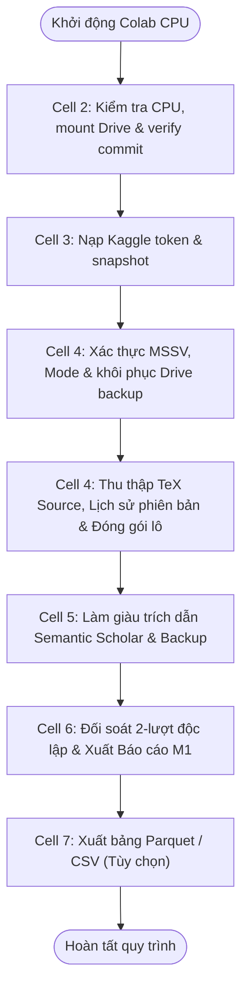

# M1 Colab Production Notebook — Static Audit Report

**Sổ tay được kiểm toán:** `notebooks/m1_colab_fast_production.ipynb`  
**SHA-256:** `ab557b31f2bd89c35e0e89a04f9cd9bb05f9206f8040647bef8b6ebb485c12ce`  
**Thời điểm lập:** 2026-11-10T00:04:40+07:00  
**Người thực hiện:** Antigravity (Google DeepMind Team)  
**Phương pháp:** Static AST & Control-Flow Analysis (Evidence Level E0)  

---

## 1. Cấu Trúc Tổng Quan & Tệp Sổ Tay (Notebook Structure)

- **Định dạng:** Jupyter Notebook v4.0 (JSON hợp chuẩn, không có lỗi phân tích cú pháp).
- **Tổng số ô lệnh (Cells):** 8 cells (2 Markdown, 6 Code).
- **Trạng thái Output:** Toàn bộ 6 code cells đều ở trạng thái sạch (`execution_count: null`, `outputs: []`). Không có dữ liệu rò rỉ, không có kết quả chạy cũ, không có thông tin cá nhân hay token xác thực.
- **Tính khả thi của "Restart session and run all":** Hợp lệ. Các ô lệnh được sắp xếp theo đúng trình tự phụ thuộc tuyến tính từ chuẩn bị môi trường đến xuất dữ liệu.

---

## 2. Kiểm Toán Từng Ô Lệnh (Cell-by-Cell Audit)

### Cell 0 (Markdown) — Colab Badge Link
- **Nội dung:** Liên kết mở trực tiếp trên Colab trỏ tới `https://colab.research.google.com/github/Toan-ten/Arxiv-Project-Group10/blob/feat%2Fm1-t02-colab-resume/notebooks/m1_colab_fast_production.ipynb`.
- **Đánh giá:** Hợp chuẩn. Trỏ đúng nhánh `feat/m1-t02-colab-resume` và đúng đường dẫn tệp.

### Cell 1 (Markdown) — Hướng Dẫn Vận Hành
- **Nội dung:** Quy định bắt buộc về phần cứng CPU-only (None), quy tắc đơn tiến trình ghi (single-writer), cấu hình Secrets (`KAGGLE_API_TOKEN`, `S2_API_KEY`) và kiến trúc tăng tốc SSD / RAM-disk.
- **Đánh giá:** Rõ ràng, nhất quán với mã lệnh thực thi ở các ô tiếp theo.

### Cell 2 (Code) — Bước 1: Khởi Tạo Môi Trường & Kiểm Tra Nguồn Gốc Mã
- **Nguồn gốc mã nguồn:**
  - `CODE_COMMIT = "489a82fd959ccc6cced7c59fc309255e4421bef2"` (Mốc lịch sử đối chiếu).
  - `EXECUTION_COMMIT = "69b4b5e758f74d255ff244c56271e294da57b8e4"` (Mốc thực thi mã nguồn runtime).
- **Bảo vệ phần cứng:** Phát hiện `os.environ.get("COLAB_GPU") == "1"` và ném `RuntimeError` nếu người dùng bật nhầm GPU.
- **Bảo vệ mã nguồn (Fail-closed):**
  - Kiểm tra regex 40 ký tự hex cho cả hai commit.
  - Thực hiện `git fetch origin` và `git checkout --detach EXECUTION_COMMIT`.
  - Đối chiếu `git rev-parse HEAD == EXECUTION_COMMIT`. Bất kỳ sai lệch nào đều chặn đứng thực thi.
- **Cài đặt thư viện:** Chạy `pip install -q -r requirements.txt`.
- **Đánh giá:** Đạt mức bảo vệ cao nhất (Fail-closed).

### Cell 3 (Code) — Bước 2: Nạp Cấu Hình Kaggle API & Chuẩn Bị Snapshot
- **Bảo mật:** Đọc `KAGGLE_API_TOKEN` từ biến môi trường hoặc `google.colab.userdata.get("KAGGLE_API_TOKEN")`.
- **Lưu trữ:** Ghi vào `~/.kaggle/access_token` với quyền bảo mật nghiêm ngặt `chmod 0o600`.
- **Phục hồi:** Nếu không có token hoặc mạng lỗi, hệ thống in cảnh báo hướng dẫn và tiếp tục ở chế độ Discovery trực tiếp qua Atom API mà không gây crash sổ tay.
- **Đánh giá:** An toàn, không để lộ bí mật, xử lý linh hoạt (graceful fallback).

### Cell 4 (Code) — Bước 3: Thu Thập Mã Nguồn TeX & Lịch Sử Phiên Bản
- **Cấu hình thành viên:**
  - `MSSV`: Nhận một trong 4 mã sinh viên nhóm (`24120010`, `24120035`, `24120232`, `24120260`).
  - `MODE`: Nhận `"MEMBER_PRODUCTION"` (50 lô được giao) hoặc `"PILOT"` (1 lô mẫu).
- **Cách ly thành viên (Member Isolation):**
  - Gọi `member_cohort_range(MSSV)`. Kiểm tra nghiêm ngặt danh sách hợp lệ, từ chối mọi MSSV lạ hoặc rỗng.
  - Chế độ `PILOT` chỉ chọn đúng 1 lô đầu tiên của thành viên đó, không thể nhầm lẫn sang toàn bộ 50 lô.
- **Phục hồi & Tiếp tục (Resume/Restore):**
  - Kiểm tra bản sao lưu `.tar.gz` trên Google Drive và khôi phục vào workspace cục bộ trước khi chạy.
  - Bật `resume=True` và `revision_history=True`.
  - Khi hoàn thành 100/100 bài báo trong một lô, gọi `verify_cohort_handoff()` kiểm toán độc lập và gắn nhãn trạng thái bàn giao.
- **Đánh giá:** Thiết kế xuất sắc, bảo đảm tính toàn vẹn và khôi phục sự cố.

### Cell 5 (Code) — Bước 4: Làm Giàu Siêu Dữ Liệu & Trích Dẫn Semantic Scholar
- **Bảo mật API Key:** Lấy từ `userdata.get("SEMANTIC_SCHOLAR_API_KEY")` hoặc `userdata.get("S2_API_KEY")`.
- **Điều tiết tốc độ (Rate Limiting):**
  - Có API key: `min_interval = 1.0s` (hạn mức cao).
  - Không có API key: `min_interval = 3.0s` (hạn mức công cộng 100 req / 5 phút).
- **Tính độc lập:** Tách biệt hoàn toàn với bước tải source TeX. Chỉ làm giàu cho các bài báo đã hoàn tất source hợp lệ.
- **Đánh giá:** Tuân thủ Storage Contract v2 và Rate Limiting Policy.

### Cell 6 (Code) — Bước 5: Kiểm Toán Chất Lượng Dữ Liệu & Lập Báo Cáo M1
- **Đối soát độc lập:** Sử dụng `compute_m1_statistics(runner.store, all_pairs)` đọc trực tiếp từ đĩa (Corpus Storage) thay vì bộ nhớ tạm.
- **Xuất báo cáo:** Định dạng Markdown theo quy chuẩn Milestone 1 và lưu vào Google Drive tại `DRIVE_ROOT/reports/m1_audit_summary_mssv_{MSSV}_{MODE}.md`.
- **Đánh giá:** Đạt chuẩn đối soát độc lập.

### Cell 7 (Code) — Bước 6: (Tùy Chọn) Xuất Bảng Dữ Liệu Parquet & CSV
- **Bảo vệ hợp đồng:** Có ghi chú rõ ràng rằng bước này là tùy chọn độc lập, Raw Corpus trên ổ đĩa mới là nguồn chân lý bàn giao của M1.
- **Cơ chế fail-safe:** Gọi `export_papers_table` và `export_references_table` với `verified_only=True`. Bọc toàn bộ trong khối `try...except` để nếu có lỗi thư viện phụ trợ (như pandas/pyarrow phiên bản cũ) thì không làm ảnh hưởng tới tính toàn vẹn của dữ liệu đã thu thập.
- **Phát hiện kiểm toán (Finding F-STATIC-01):** Ô lệnh này sử dụng biến `all_pairs` được khởi tạo tại Cell 6. Nếu người dùng chỉ chạy Cell 7 mà bỏ qua Cell 6, sẽ phát sinh lỗi `NameError: name 'all_pairs' is not defined`.
- **Phát hiện kiểm toán (Finding F-STATIC-02):** Biến `DRIVE_ROOT = '/content/drive/MyDrive/Group10_M1_Production'` được gán cứng lại ở Cell 7, có thể ghi đè nếu người dùng đã tùy biến đường dẫn ở Cell 4.

---

## 3. Danh Sách Phát Hiện Kiểm Toán Tĩnh (Static Findings Register)

| ID | Mức độ | Vị trí | Hiện tượng thực tế | Hành vi kỳ vọng | Đề xuất khắc phục |
| :---: | :---: | :---: | :--- | :--- | :--- |
| **F-STATIC-01** | **Medium** | Cell 7 (Bước 6) | Phụ thuộc biến `all_pairs` khởi tạo từ Cell 6. Nếu người dùng chỉ chạy ô Cell 7 thì bị `NameError`. | Cell 7 phải tự chứa (self-contained), tự tính `all_pairs` nếu biến chưa tồn tại trong `globals()`. | Bổ sung logic kiểm tra và tự khởi tạo `all_pairs` từ `COHORT_LIST` nếu chưa có. |
| **F-STATIC-02** | **Low** | Cell 7 (Bước 6) | Gán cứng lại `DRIVE_ROOT = '/content/drive/MyDrive/Group10_M1_Production'` thay vì kế thừa biến từ Cell 4. | Kế thừa đường dẫn đã định nghĩa ở Cell 4 nếu có. | Dùng `DRIVE_ROOT = globals().get('DRIVE_ROOT', '/content/drive/MyDrive/Group10_M1_Production')`. |

---

## 4. Biểu Đồ Luồng Thực Thi (Execution Graph)

